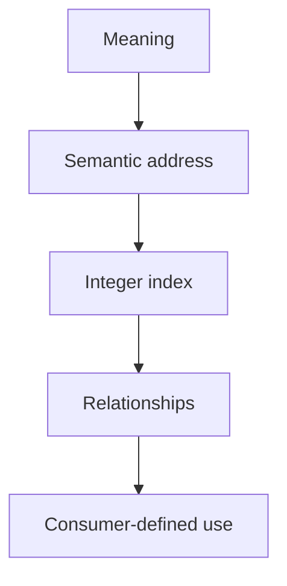
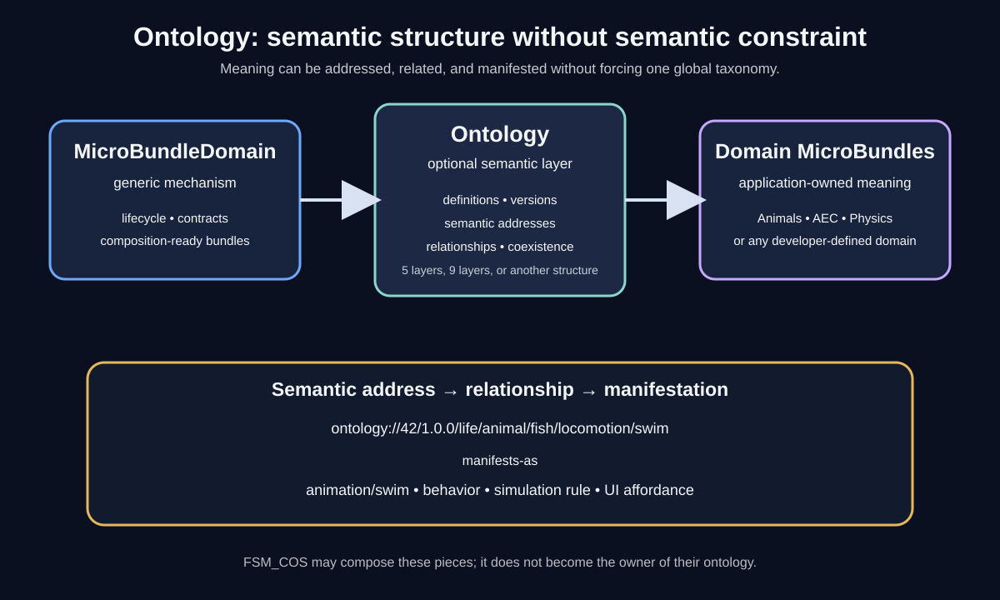

# The Singularity Workshop — Ontology


[](https://github.com/TrentBest/TheSingularityWorkshop.Ontology/actions/workflows/sith-policy.yml)
> **Optional semantic contracts—not a mandatory global ontology.**

The Workshop needs semantic structure that can grow beyond renderer-specific conditionals without turning one schema into a rule every MicroBundle must follow.



## 🟦 01 What

It provides optional contracts for semantic addresses, indexes, and relationships. Consumers choose whether and how to adopt them; the package does not impose one mandatory ontology.

## 🟣 02 Why

A global mandatory schema would make every capability depend on one model of the world. Optional ontology contracts let applications share semantic addresses and relationships when useful while leaving other MicroBundles free to use different or coexisting schemes.

## 🔺 03 How

Give a concept an address, index, and relationships where useful; let consumers decide how to use those relationships. Ontology remains an optional capability rather than a gatekeeper.

## 🟢 04 See it in a minute

Read the architecture and theory first, then run the package tests to inspect the current contracts and their guarantees.

## 🟪 05 Documentation and theory

[Canonical nine-layer model](docs/NINE-LAYER-MODEL.md) · [Ontology landscape](docs/ONTOLOGY-LANDSCAPE.md) · [Architecture](docs/ARCHITECTURE.md) · [Theory](docs/THEORY.md) · [Mathematics](docs/MATHEMATICS.md)

---

## Detailed guide



**Ontology is a MicroBundle, not a constraint on MicroBundles.**

This package provides independent contracts for defining, versioning, indexing, addressing, and relating ontological information. It deliberately does **not** require every MicroBundle to use The Singularity Workshop's ontology.

## Why this exists

The Workshop needs semantic structure that can scale beyond renderer-specific conditionals without turning that structure into a mandatory global schema.

A useful mental model is:

```text
meaning
   |
   v
semantic address
   |
   v
integer index
   |
   v
relationship
   |
   v
manifestation
```

For example, an application could express a fish's swimming concept as an ontology address and relate it to a swimming behavior or animation. The renderer can consume the relationship without becoming an animal-taxonomy engine.

Read the deeper design rationale in [docs/THEORY.md](docs/THEORY.md) and the implementation boundary in [docs/ARCHITECTURE.md](docs/ARCHITECTURE.md).

## Ranges and placement-neutral coverage

[Ontology ranges and coverage](docs/ONTOLOGY-RANGES.md) define validated half-open semantic intervals and an opaque server-coverage metadata record. Ontology does not discover servers, route requests, or perform storage.

## 60-Second Quick Start

Ontology targets **.NET 8 and .NET 10**. The source project currently declares `0.1.0-alpha.3`; that declaration is not proof that the exact version is available from NuGet. Verify the published version on the [NuGet package page](https://www.nuget.org/packages/TheSingularityWorkshop.Ontology) before using a package-install command. Until then, use a local project reference.

### 1. Create a .NET 8 or .NET 10 console application

Create a Console App in Visual Studio or with the .NET CLI.

### 2. Reference the local source

Clone this repository next to your application and run this from the directory containing your application's project file. Adjust the relative path if your folders differ:

```powershell
dotnet add reference ..\\TheSingularityWorkshop.Ontology\\TheSingularityWorkshop.Ontology.csproj
```

### 3. Create a canonical nine-layer address

```csharp
using TheSingularityWorkshop.Ontology;

var ontology = WorkshopOntologySchema.CreateDefinition(
    ontologyId: 1001,
    name: "Workshop",
    version: "1.0.0",
    101, 102, 103, 104, 105, 106, 107, 108, 109);

var index = OntologyIndex.Create(1, 2, 3, 4, 5, 6, 7, 8, 9);
var address = WorkshopOntologySchema.CreateAddress(
    ontology,
    "life/animal/fish",
    index);

Console.WriteLine(address);
Console.WriteLine($"Index: {address.Index}; rank: {address.Index.Rank}");
```

Expected output:

```text
ontology://1001/1.0.0/life/animal/fish
Index: [1,2,3,4,5,6,7,8,9]; rank: 9
```

The layer IDs in this example are illustrative stable identifiers supplied by the ontology owner. They are not generated from the position numbers. The helper validates the canonical layer names/order and requires a nine-coordinate index.

For a generic ontology, use `OntologyDefinition`, `OntologyIndex`, and `OntologyAddress` directly; the generic contracts do not force nine layers.

## Add It to an Existing Project

Reference Ontology only where your domain benefits from semantic addresses, indexes, or relationships. It is not a requirement for every MicroBundle or application.

Ontology depends on MicroBundleDomain, but **does not depend on ProtocolAI or FSM_COS**. A consumer may use ProtocolAI to map its own vocabulary to integer IDs, but that mapping is optional and belongs on the consumer side. FSM_COS can compose resolved MicroBundles without hard-coding ontology-specific meaning.

## Workflow and presentation boundaries

Ontology provides semantic contracts and local validation; it does not schedule workflows, execute tasks, or require a GUI. [FSM_Execution](https://github.com/TrentBest/TheSingularityWorkshop.FSM_Execution) may invoke Ontology operations as workflow capabilities, while FSM_COS composes the participating MicroBundles. See [Architecture](docs/ARCHITECTURE.md#knowledge-operations-are-not-workflow-execution) for the exact ownership boundary and current implemented surface.

## Integer indexing without a ProtocolAI dependency

Ontology uses a deliberately small, protocol-neutral indexing primitive: `OntologyIndex`.

The default representation is one integer:

```text
OntologyIndex(42)
```

When a semantic model benefits from layers or array-like coordinates, the same primitive expands to an ordered set of integer dimensions:

```text
OntologyIndex.Create(2, 14, 7, 3)

dimension 0 -> 2
dimension 1 -> 14
dimension 2 -> 7
dimension 3 -> 3
```

There is **no ProtocolAI package reference in Ontology**.

That is intentional. ProtocolAI can be used by a consumer as the vocabulary/identity layer that maps strings or protocol symbols to integer IDs, while Ontology only sees the resulting integer index:

```text
human vocabulary
      |
      v
ProtocolAI (optional consumer-side mapping)
      |
      v
integer ID
      |
      v
OntologyIndex
      |
      v
semantic address
```

This keeps Ontology useful with ProtocolAI, without making ProtocolAI part of Ontology's dependency boundary.

ProtocolAI's current symbols are explicitly assigned integer IDs; they are not required to be cryptographic hashes. If another vocabulary system uses hashes, database keys, generated IDs, or local array indexes, those values can also be represented by `OntologyIndex` where their semantics are appropriate.

## Single dimension by default, multiple dimensions by choice

The indexing model deliberately does not impose a nine-layer or five-layer ontology.

A simple ontology can remain:

```text
[concept]
   |
   +-- integer index: 42
```

A layered ontology can express the location as coordinates:

```text
[layer 0, layer 1, layer 2, layer 3, layer 4]

[2, 14, 7, 3, 91]
```

The number of dimensions is determined by the ontology using them. The core does not assume that every ontology has the same rank. The Workshop's own canonical classification uses nine ordered positions (Paradigm → Domain → Kingdom → Phylum → Class → Order → Family → Genus → Species); that canonical model is documented separately and is not imposed on independent ontologies.

This gives us a compact runtime/storage representation while preserving the human-readable semantic path for authoring, diagnostics, and explanation.

## Design boundary

```text
MicroBundleDomain
    defines the generic MicroBundle mechanism
             |
             +-------------------+
             |                   |
          Ontology          application content
             |
      defines its own
      semantic structure
             |
       OntologyIndex
       scalar or N-D
```

A developer using `The.SingularityWorkshop.MicroBundleDomain` may build a five-layer model, a nine-layer model, no ontology at all, or an entirely different structure. Ontology exists to make semantic structure available when a developer chooses it.

## Coexisting ontologies

An application may load multiple independently defined ontologies at the same time. Ontologies are identified by an explicit ID and version; no ontology is silently promoted to a universal schema.

The Singularity Workshop can publish a master ontology as **content** that contains domains such as the animal kingdom, physics, materials, AEC, or other knowledge families. That master ontology remains an ontology definition, not a requirement imposed on unrelated MicroBundles.

Different ontologies can also choose different index dimensionality:

```text
Animals
  1 integer

AEC
  5 dimensions

Physics
  3 dimensions

Application-specific ontology
  whatever its model requires
```

## Semantic addresses

Ontology addresses allow behavior and data to be located by meaning rather than by renderer-specific conditionals:

```text
ontology://<ontology-id>/<version>/<semantic-path>
```

For example:

```text
ontology://42/1.0.0/life/animal/fish/locomotion/swim
```

The address can additionally carry its compact `OntologyIndex` without replacing the readable path.

An ontology relationship can connect that semantic concept to a manifestation such as a behavior, animation, simulation rule, or UI affordance.

## Dependency direction

- `TheSingularityWorkshop.Ontology` may depend on `TheSingularityWorkshop.MicroBundleDomain`.
- `MicroBundleDomain` must remain independent of Ontology.
- `Ontology` does **not** depend on ProtocolAI.
- ProtocolAI can be an optional consumer-side vocabulary/identity source for Ontology indexes.
- `MicroBundleRepository` stores/retrieves content without requiring ontology knowledge.
- `FSM_COS` may compose ontology MicroBundles but does not hard-code ontology-specific meaning.

This keeps the mechanism reusable while allowing richer semantic systems to grow above it.

## Address-space mathematics

The indexing model is intentionally backed by explicit mathematics rather than a vague claim of “large scale.”

A single `ulong` coordinate has:

$$
2^{64}
$$

possible values.

For N dimensions with extents $D_0, D_1, \\dots, D_{N-1}$, the address-space cardinality is:

$$
|A| = \\prod_{i=0}^{N-1} D_i
$$

If every dimension uses the complete 64-bit coordinate domain:

$$
|A| = (2^{64})^N = 2^{64N}
$$

That means a five-dimensional full-`ulong` coordinate space contains $2^{320}$ possible addresses, while a nine-dimensional space contains $2^{576}$.

Those are **addressable possibilities**, not an instruction to allocate an array that large. The ontology describes semantic space; repositories and runtimes materialize only the portions that actually exist.

`OntologyIndexSpace` makes the distinction concrete. It can:

- describe bounded N-dimensional extents;
- calculate exact cardinality with `BigInteger`;
- flatten a coordinate into a row-major dense-array offset;
- reverse that offset back into the semantic coordinate.

See **[Address-space mathematics](docs/MATHEMATICS.md)** and the [address-space visual](docs/address-space.svg).

## The N-dimensional model

The core remains one integer by default:

`OntologyIndex(42)`

When a domain needs layers or arrays, it expands without changing the identity primitive:

`OntologyIndex.Create(2, 14, 7, 3)`

The rank belongs to the consuming ontology. There is no Workshop-wide requirement that an ontology have five, nine, or any other number of layers.

## NuGet package

This repository is the canonical home of the Workshop's optional ontology contracts. The package is designed to be consumed independently by applications that choose semantic addressing.

The dependency direction remains deliberate:

```text
MicroBundleDomain
      |
      +----> Ontology
      |
      +----> application/domain MicroBundles

ProtocolAI --optional consumer-side vocabulary mapping--> OntologyIndex
FSM_COS ----composes declared pieces---------------------> runtime
MicroBundleRepository ----stores materialized artifacts-> storage
```

Ontology does **not** depend on ProtocolAI, FSM_COS, or the repository implementation.

## Ecosystem example

The intended use is not “make everything an ontology.”

It is:

1. define semantic structure where it adds value;
2. give that structure stable addresses;
3. use relationships to connect meaning across independently owned domains;
4. let FSM_COS compose the participating MicroBundles;
5. let renderers, simulations, UI, or other manifestations consume the resolved meaning;
6. materialize only the data and behavior that actually exists.

This makes the Ontology package a concrete example of the Workshop's broader principle:

> **Optional structure should remain optional, while the structures that do exist should be explicit, addressable, and composable.**

## Documentation map

- **[Nine-layer model](docs/NINE-LAYER-MODEL.md)** — the canonical Workshop layer names, why nine, why not ten, and the mathematical model.
- **[Nine-layer visual](docs/nine-layer-model.svg)** — a visual map of classification and orthogonal structures.
- **[Ontology landscape](docs/ONTOLOGY-LANDSCAPE.md)** — how BFO, DOLCE, GFO, UFO, and SUMO relate to the Workshop's classification model.
- **[Theory](docs/THEORY.md)** — why semantic structure is optional and how meaning can become addressable.
- **[Architecture](docs/ARCHITECTURE.md)** — package boundaries and semantic resolution.
- **[Mathematics](docs/MATHEMATICS.md)** — N-dimensional address-space cardinality and dense-array mapping.
- **[Ontology boundary visual](docs/ontology-boundary.svg)** — dependency and ownership boundaries.
- **[Semantic resolution visual](docs/semantic-resolution.svg)** — meaning to manifestation.
- **[Address-space visual](docs/address-space.svg)** — scalar, N-dimensional, and linearized indexing.

---

**The Singularity Workshop**

[GitHub](https://github.com/TrentBest/TheSingularityWorkshop.Ontology) · [NuGet](https://www.nuget.org/packages/TheSingularityWorkshop.Ontology)

*Meaning can be addressable without making one ontology mandatory.*

---

<p align="center">
  <a href="https://github.com/TrentBest/TheSingularityWorkshop" aria-label="The Singularity Workshop living avatar">
    
  </a><br />
  <strong>The Singularity Workshop</strong><br />
  <em>If a picture is worth a thousand words, what is a living picture worth?</em><br />
  <a href="https://github.com/TrentBest">GitHub</a> · <a href="https://www.patreon.com/TheSingularityWorkshop">Support the Workshop</a>
</p>
