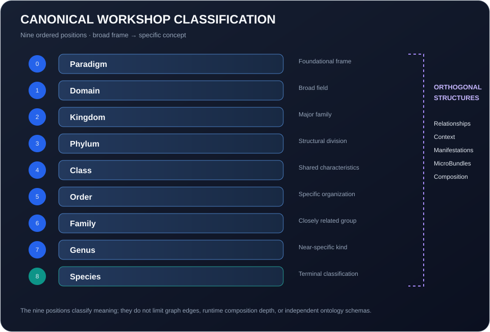

# The Nine-Layer Ontology



This document records the Workshop's canonical nine-position semantic classification model, the reason for its shape, its mathematical interpretation, and the boundary between this model and the more general ontology contracts implemented by this package.

The nine layers are a **canonical Workshop model**, not a universal law imposed on every ontology or MicroBundle. The library must remain capable of representing other ranks and structures. The Workshop's own ontology can nevertheless choose nine positions deliberately and consistently.

## 1. The canonical ordered layers

The canonical coordinate has nine ordered positions, numbered from zero:

| Position | Layer | Responsibility | Question it helps answer |
|---:|---|---|---|
| 0 | **Paradigm** | Foundational frame, worldview, or organizing model | Under what conceptual frame is this being described? |
| 1 | **Domain** | Broad field of knowledge or activity | What broad subject does it belong to? |
| 2 | **Kingdom** | Major family of subject matter within a domain | What major kind of thing or knowledge family is it? |
| 3 | **Phylum** | Structural or organizational division | What broad structural pattern distinguishes it? |
| 4 | **Class** | Shared defining characteristics | What class of things share those characteristics? |
| 5 | **Order** | More specific organization of related classes or concepts | What organized grouping does it belong to? |
| 6 | **Family** | Closely related concepts with shared lineage or structure | Which closely related group contains it? |
| 7 | **Genus** | Near-specific conceptual kind | What immediate kind is it? |
| 8 | **Species** | Terminal classification position in this model | Which precise classified concept is intended? |

These names deliberately borrow a familiar progression from broad framing toward specific classification. They are used as semantic layer names in an engineering model; the model does **not** claim that every subject is biologically taxonomic, nor that Paradigm through Species are exact equivalents of the ranks in biological nomenclature.

The position is part of the meaning. A value at position 8 is not interchangeable with the same numeric value at position 2. The coordinate is an ordered tuple, not an unordered set.

### Names that are not additional layers

A **Moniker** is an identity or presentation concept, not a tenth layer. A **TopicToken** is a vocabulary/token concept, not a replacement name for the ninth layer. A topic token may identify a value used at a position, including the terminal position, but it does not change the layer schema.

Likewise, gestures, behaviors, capabilities, manifestations, and MicroBundles are not automatically new ontology layers. They may be classified by an ontology, related to ontology addresses, or composed as independent runtime capabilities. The Workshop's four-universe framing, written as R ∪ F ∪ U ∪ A, is also orthogonal to the nine-position count; it does not add four more classification positions.

## 2. Why nine positions?

Nine is the Workshop's chosen canonical semantic decomposition: one broad framing position followed by eight progressively more specific classification positions. It gives the canonical model a stable, fixed-arity address while leaving the library's general contracts free to support other ontologies.

The choice is an engineering and modeling decision, not a theorem that nature contains exactly nine universal categories. Existing upper-ontology and knowledge-representation traditions—including BFO, DOLCE, GFO, UFO, and SUMO—offer useful ideas and competing commitments; their existence does not establish that every useful ontology must have nine layers. The Workshop's nine positions should be defended by the work they do in this system, not by claiming that other ontologies prove the number.

The practical advantages are:

1. **Stable coordinate shape.** A canonical Workshop address can be represented and compared as a nine-position tuple.
2. **Progressive refinement.** The positions move from broad conceptual frame to a specific classified concept.
3. **Consistent vocabulary placement.** A resolver can interpret a value according to its position rather than guessing from the integer alone.
4. **Room for independent meaning graphs.** Relationships, providers, manifestations, and runtime composition remain separate structures rather than being forced into the classification tuple.
5. **Recursive composition without rank inflation.** A MicroBundle can contain or depend on other MicroBundles without each nested capability consuming another ontology layer.

The number nine therefore describes the chosen *classification coordinate*, not the total complexity of the Workshop, the maximum number of relationships, or the maximum depth of a MicroBundle composition tree.

## 3. Why not a tenth layer?

The burden of proof for a proposed tenth layer is semantic, not numerical. A new layer is justified only when it represents an independent classification distinction that cannot be expressed faithfully by the existing model.

Before adding one, test whether the proposed distinction is already represented by:

- a value at one of the nine existing positions;
- a more specific value within an existing position;
- multiple classification memberships or multiple ontology addresses;
- an explicit relationship between addresses;
- a separate ontology with its own schema;
- a MicroBundle capability, dependency, or nested composition;
- environment, experience, configuration, or other contextual data;
- a manifestation or provider mapping;
- or a domain-specific extension that should remain outside the canonical model.

If one of these expresses the distinction without overloading the semantics of an existing position, a tenth coordinate is not needed. If none can, document the counterexample, show why the distinction is truly orthogonal, and demonstrate the cost of keeping it outside the coordinate before changing the canonical arity.

This is a falsifiable engineering criterion, not a claim of mathematical impossibility. The nine-layer model is sufficient for the Workshop's established classification responsibilities unless a concrete counterexample demonstrates otherwise. It is not asserted to be complete for every possible knowledge domain. The historical design record establishes the selected order and the intended separation of classification from relationships and recursive composition; it does not contain a formal proof that nine is a universal minimum. The mathematics quantifies the capacity of a nine-position model. It does not, by itself, prove that the semantic decomposition must have nine positions.

## 4. The classification coordinate is not the whole ontology

Several structures must remain distinct:

- **Classification:** the nine-position coordinate that locates a concept in the canonical semantic scheme.
- **Identity:** the qualified ontology identity and version that make an address unambiguous.
- **Relationships:** typed or named edges connecting addresses, including cross-ontology links.
- **Composition:** the graph of MicroBundles and capabilities that a runtime assembles.
- **Context:** environment, experience, configuration, and other conditions under which meaning is interpreted or behavior occurs.
- **Manifestation:** a provider, behavior, rendering, simulation, document, or other concrete realization.
- **Storage:** the repository's physical artifact and blob organization.

These are related, but they are not extra coordinate positions. In particular, a relationship graph is not a classification hierarchy, and a runtime dependency graph is not an ontology tree.

## 5. Recursive MicroBundles do not add ontology layers

MicroBundles describe independently owned, addressable, composable capabilities or content. A MicroBundle may depend on another MicroBundle; that dependency may itself have dependencies. This creates a recursive composition graph.

That graph can be arbitrarily deep without changing the nine-position classification coordinate:

```text
Nine-position semantic classification
              |
              v
       classified concept
              |
              +---- relationship graph
              |
              +---- provider MicroBundle
                         |
                         +---- dependency MicroBundle
                                      |
                                      +---- nested capability
```

The ontology answers semantic classification questions. MicroBundleDomain owns generic MicroBundle contracts and lifecycle. The repository resolves and stores artifacts. FSM_COS composes resolved pieces for execution. No one of those boundaries should be collapsed into an artificial tenth ontology layer.

## 6. Mathematical model

Let the nine coordinate positions have finite extents:

`N_0, N_1, \ldots, N_8`

where each `N_i` is the number of permitted values at position `i`. The canonical address space is the Cartesian product:

[
\Omega_9 = N_0 \times N_1 \times \cdots \times N_8
]

Its cardinality is:

[
|\Omega_9| = \prod_{i=0}^{8} N_i
]

If every position has the same extent `N`, then:

[
|\Omega_9| = N^9
]

For the illustrative bound `N = 2^{31}-1`:

[
|\Omega_9| = (2^{31}-1)^9 \approx 9.71 \times 10^{83}
]

This is a count of possible coordinates under that assumed bound. It is not a claim that the implementation currently allocates that many values, that each layer uses this exact bound, or that a signed 31-bit limit is enforced by the current `ulong` coordinate type.

The implementation's generic `OntologyIndex` uses unsigned 64-bit coordinate components. If all nine positions independently admitted the complete `ulong` value domain, the theoretical product would instead be:

[
(2^{64})^9 = 2^{576}
]

The two calculations answer different questions: the first is a bounded-domain design example; the second is the capacity of nine full-width `ulong` coordinates. Documentation and code must never silently conflate them.

A coordinate is an element of the product space. A semantic path, ontology ID, version, or relationship is additional identity/context; it is not automatically one of the nine numeric coordinates.

## 7. Canonical model versus general-purpose library

The package must not hard-code nine as the only valid rank. `OntologyDefinition` declares the layers belonging to a particular ontology, while `OntologyIndex` and `OntologyIndexSpace` provide scalar and N-dimensional coordinate mechanisms.

That separation is intentional:

- The **Workshop canonical ontology** uses the nine ordered positions described here.
- An independent ontology may use a different number of layers, a flat vocabulary, multiple inheritance, or a graph-first model.
- A consumer may use no ontology.
- The runtime must not infer that every arbitrary N-dimensional index is a nine-layer Workshop coordinate.

When an address claims to use the canonical Workshop model, its definition and coordinate must be validated against that model's declared nine-position schema. Generic ontology contracts remain generic.


### Enforcing the canonical profile in code

The generic contracts remain flexible. Code that intends to create a canonical Workshop address should use `WorkshopOntologySchema`, which centralizes the nine names and order and validates the coordinate rank:

```csharp
var ontology = WorkshopOntologySchema.CreateDefinition(
    1001,
    "Workshop",
    "1.0.0",
    101, 102, 103, 104, 105, 106, 107, 108, 109);

var index = OntologyIndex.Create(1, 2, 3, 4, 5, 6, 7, 8, 9);
var address = WorkshopOntologySchema.CreateAddress(
    ontology,
    "life/animal/fish",
    index);
```

Layer IDs are supplied by the ontology owner and remain distinct from their zero-based positions. The helper rejects a definition that does not have the canonical nine names/order and rejects an index whose rank is not nine. This prevents a generic scalar or four-dimensional index from being silently described as a complete canonical nine-layer coordinate.

## 8. Design invariants

1. Layer order is explicit and stable within a published ontology version.
2. A coordinate's position is semantically significant.
3. A layer's numeric value is interpreted only in the context of its ontology identity, version, and position.
4. Moniker and TopicToken are concepts, not additional layer names.
5. Relationships and composition dependencies are separate graphs.
6. Nested MicroBundles do not increase ontology rank.
7. Runtime-local numeric handles are not portable semantic identities.
8. A schema change that changes layer meaning or order requires an explicit ontology version change and compatibility treatment.

## Related material

- [Ontology theory](THEORY.md)
- [Ontology landscape](ONTOLOGY-LANDSCAPE.md)
- [Address-space mathematics](MATHEMATICS.md)
- [Architecture and ownership boundaries](ARCHITECTURE.md)
